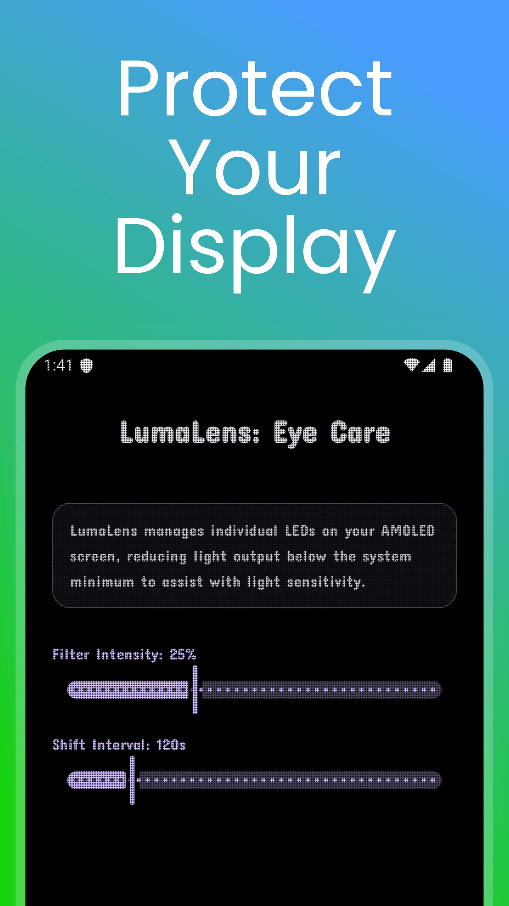
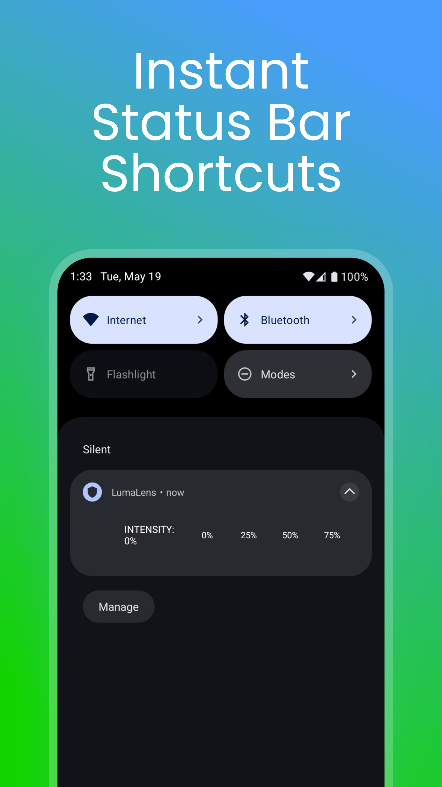

#  LumaLens: OLED Screen Dimmer

  
  &nbsp;&nbsp;&nbsp;&nbsp;
  

  
  
  

  
  

LumaLens is a production-grade Android utility engineered to protect AMOLED display panels against static image burn-in while drastically reducing eye strain in low-light environments. Utilizing a system-wide hardware overlay coupled with micro-pixel shifting, LumaLens optimizes display longevity without sacrificing system performance.

---

##  Live on Google Play
Experience the app live in action:
 **[Download LumaLens on the Google Play Store](https://play.google.com/store/apps/details?id=com.github.peacefuldivide.lumalens)**

---

##  Key Technical Features

* **True-Black Mesh Rendering (`MeshDrawable`):** Bypasses standard software opacity overlays by programmatically rendering a hardware-accelerated grid that switches off target organic light-emitting diodes (OLEDs) at the sub-pixel level.
* **Dynamic Pixel Shifting:** Implements an automated background task loop that shifts the active matrix layout coordinates at configurable time intervals, distributing thermal and electrical wear evenly across the display panel.
* **System-Wide Accessibility Integration:** Operates cleanly as a foreground-bound `AccessibilityService`, ensuring persistent uptime and instantaneous responsiveness across all installed applications and launcher screens.
* **Dual-App Ecosystem & Licensing Architecture:** Features a modular monetization split utilizing a lightweight, signature-verified "Pro Unlocker" companion app communicating securely via internal package validation and the Google Play Billing API.
* **Zero-Overhead State Persistence:** Leverages asynchronous `SharedPreferences` caching and robust lifecycle management to ensure user preferences, intensity thresholds, and scheduling parameters survive cold application reboots seamlessly.

---

##  Engineering & Architecture Highlights

* **Android 11+ Compatibility:** Solved complex window layout constraints by overriding traditional system-bar padding protocols, forcing custom accessibility window layers (`TYPE_ACCESSIBILITY_OVERLAY`) to accurately render behind 3-button navigation bars and display cutouts.
* **Optimized Event-Driven Lifecycle:** Built to adhere to strict battery-efficiency standards—avoiding heavy polling loops or background telemetry, and relying instead on reactive event handlers and lightweight `BroadcastReceiver` command pipelines.
* **Production Security:** Hardened with custom R8/ProGuard obfuscation rules, custom signing configurations, and rigorous Google Play License Testing compliance.

---

##  Tech Stack

* **Language:** 100% Kotlin
* **UI Framework:** Material Components for Android, ViewBinding, ConstraintLayout, Fragments
* **Core APIs:** AccessibilityService, WindowManager, NotificationManager, Google Play Billing Library
* **Concurrency:** Kotlin Coroutines & Main-Thread Handlers

---

##  Developed By
*[AltTab Technologies LLC](https://alttabtech.com)*  
*Building performant, utility-driven Android software focused on hardware longevity and user privacy.*